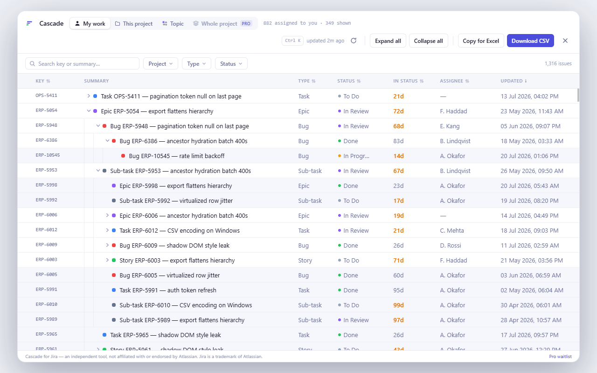
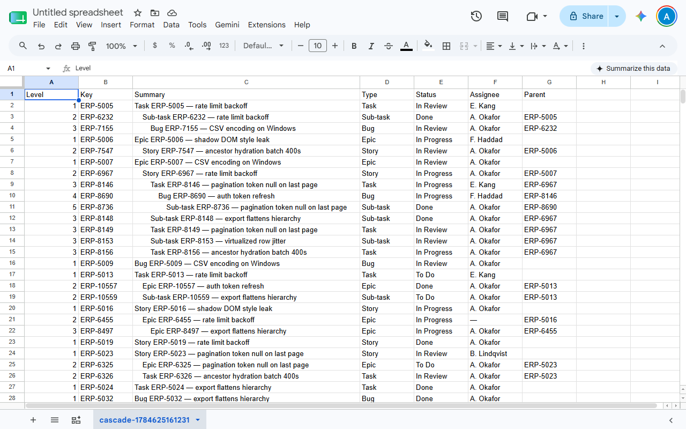

# Cascade for Jira

Cascade for Jira is a Chrome extension I built that shows Jira Cloud work as a tree inside the Jira tab. It is for project managers and team leads who read and report on work in Jira and have no administrator to install tools for them. Links: [website](https://cascadeforjira.com) and [Chrome Web Store listing](https://chromewebstore.google.com/detail/cascade-for-jira/fjmoolgncjkbnjdecpjpikjeambkihfg). The source code is private. This repo is a write-up and holds no product code.

## The problem

Jira search results are flat lists. An epic, its stories and their subtasks are linked, but a filtered list drops the links and leaves rows with no parent. Exporting a list to a spreadsheet loses the structure too, so people rebuild it by hand.

There was a second gap. Jira keeps an issue's history but does not show what changed in a description since you last looked.

Tools that fix this usually need a Jira administrator to install them. A browser extension does not. Cascade runs in the user's own Jira tab and reads Jira through the session that is already signed in. There is no separate account, no API token and no server of mine in between.

## What I built

Cascade opens as a panel over the Jira page, with four tabs: Assigned to me, Epic view, Whole space and Inbox.

*A Chrome Web Store screenshot on sample data. Some tab names have changed since.*

- **Tree and filters.** Search accepts several words. Filters can say "is not". Saved views remember an epic selection per space.
- **Detail drawer.** Click a row to read the description and comments beside the tree. Replies post as real Jira replies.
- **Exact diffs.** Edits to rich-text fields show as a word-level diff, built from Jira's change history.
- **Inbox.** Mentions, assignments and watched issues in one list.
- **Export.** Copy for Excel or download CSV, flat or indented.

## Decisions worth explaining

**1. Stream the load instead of waiting for it.** Jira's search API returns at most 100 issues per page and gives no total. A real project of about 5,800 issues takes around 58 requests, which my notes put at 10 to 20 seconds. I render each page as it arrives, so the tree grows while loading. Rebuilds are batched, about 8 per full load instead of 58. Retries sit in one fetch function that honors the rate-limit header. A 50,000-issue ceiling shows a banner instead of truncating silently. I rejected fetch-everything-then-render, which means a long spinner, and a Web Worker from day one. Later I measured the tree build at 17.3 ms for 20,000 issues, so the worker was not needed. A test also fails the build if the compressed script grows past a set size.

**2. Build hierarchy from levels, not type names.** A tester used Initiative, Epic, Story and Sub-task, and Cascade stopped at Epic. The code compared type names to the word "Epic" and ignored the numeric level Jira already sends. The planned design reads that level and builds missing parents from data already in each response, so the usual case needs no extra requests. I rejected a configurable list of names, which breaks when an administrator renames a level. I also rejected fetching level definitions first, and walking up one issue at a time. The cost is a one-time cache reset for every user. This one is designed but not built. I have not seen a level above Epic on a live site, so the first step is a test on one.

**3. Remember filters per tab and per space.** In August I made filters clear on every tab switch. Before that, a filter could stay active in a tab with no control to show it, so rows went missing without explanation. The price was retyped filters. Now filters are stored per tab and per space and never carried across tabs, so every active filter has a visible chip. When restored filters have not been seen for more than 30 minutes, a banner says they are still on. I rejected carrying filters across tabs, which brings the old bug back. The cost is that it only works if each tab restores the right filters for the right space.

**4. Keep the core free and delay the paywall.** Atlassian made a hierarchy view of a whole project free in March 2025, so on 1 August I made my whole-project tab free and deleted the gate code. The planned paid line is indentation in exports, not scope. Cross-project hierarchy is a paid candidate I have not built, because my notes record no proof that anyone would pay for it. The site lists no prices and calls Pro free in early access. The cost is that payments wait until I see people want the paid features.

**5. Declare more data handling than I had to.** A September audit found my privacy policy and store listing said data never leaves the browser. Cascade writes to Jira when asked, loads some images from other hosts, and keeps a cache that survives uninstall. I rewrote the policy and changed the store's privacy form from "collects nothing" to listing the data types the extension reads and stores. Nothing is sent to me. The corrected listing went live with version 0.9.3 on 10 November 2026.

## Getting users

Traffic is still small. These are the numbers as my notes record them.

- **Store title test.** I added "Tree View" to the listing name on 9 September and planned 28 days. After 26 clean days, store impressions were 7.7 a day against a baseline of 6.4. I called it inconclusive and kept the name.
- **Weekly users.** The store dashboard showed 22 weekly users on 15 October.
- **Website and guides.** The site went live on 23 September. After keyword research I wrote guides on Jira hierarchy, Excel export and subtasks, because those phrases get far more searches than "tree view".
- **Directories and community.** I listed Cascade on SaaSHub and AlternativeTo on 13 October and posted one Atlassian Community answer.
- **Search.** For the week to 23 November, Google showed the site 1,659 times with 3 clicks at average position 29.7. The week before: 691 impressions, 1 click, position 57.2. The site had 26 page views and 2 Add to Chrome clicks that week. In the 30 days to 22 November, the site recorded 3 Add to Chrome clicks, none of them from about 90 guide page views.
- **Posts.** I write about it on LinkedIn. A homepage title change reached fourth place in the US for "jira hierarchy chrome extension", but Google showed the homepage as often as before. Few people search that phrase.

## Stack

- Extension: WXT (Manifest V3), React 18, TypeScript, TanStack Table and Virtual, Tailwind v4 in a Shadow DOM
- Tests: Vitest, 1,397 tests as of 17 October 2026
- Permissions: `storage` and `https://*.atlassian.net/*` only
- Website: Next.js (built with vinext) on Cloudflare Workers, with self-hosted Rybbit analytics
